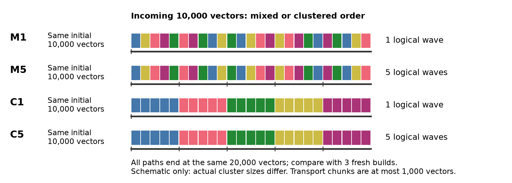
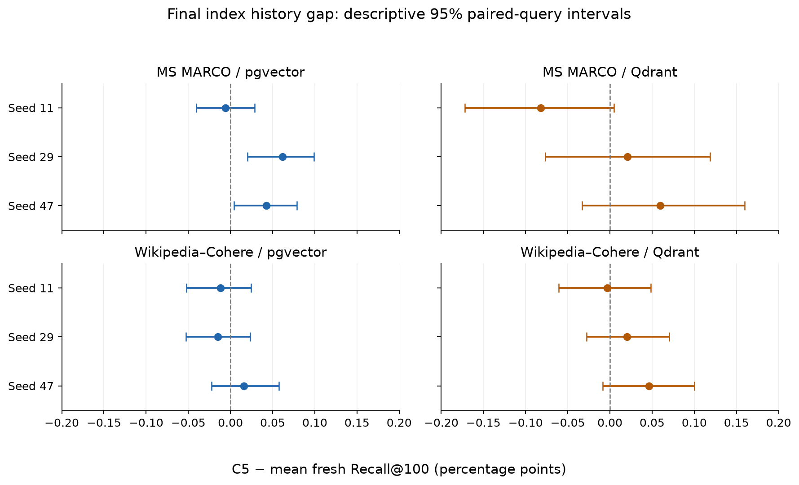
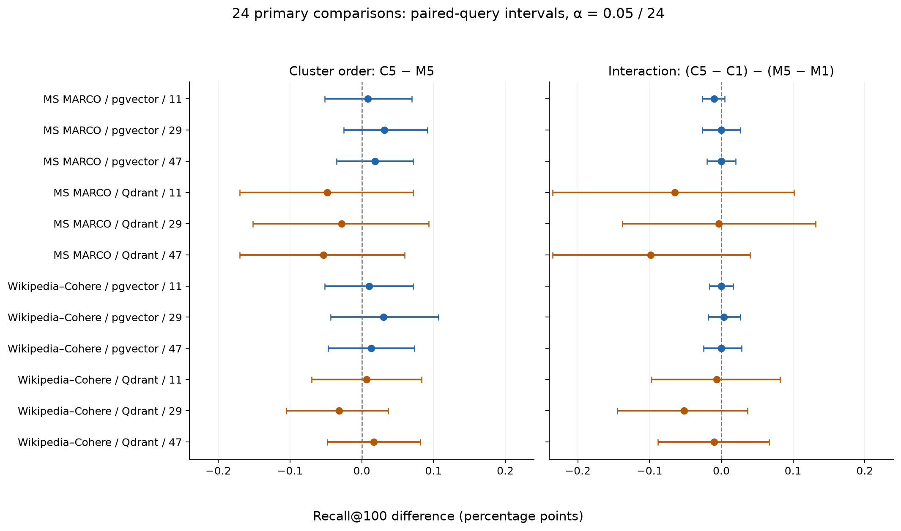
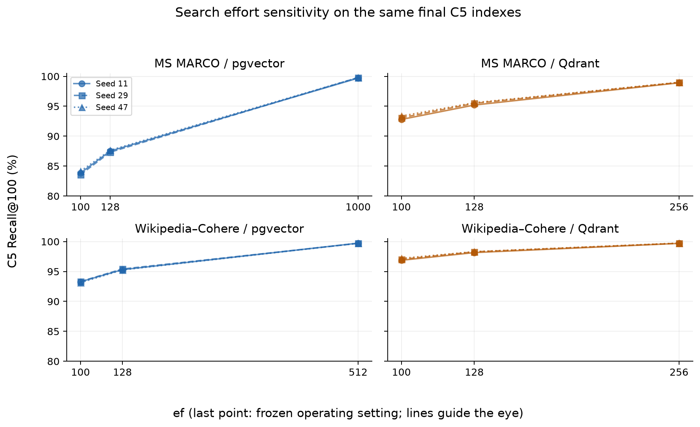

# 벡터 2만 개에서 살펴본 HNSW 증분 삽입과 검색 재현율

공개 임베딩을 이용한 pgvector·Qdrant 로컬 비교 실험 기술보고서  
실험 식별자: `clustered-20261027-02` · 작성일: 2026-10-28

## 1. 문제 제기

벡터 검색 서비스는 처음 만든 인덱스에 새로운 문서를 계속 추가한다. 신규 벡터가 검색된다는 사실만으로 기존 인덱스의 검색 품질이 유지된다고 판단할 수는 없다. HNSW는 근접한 벡터들을 연결한 그래프를 탐색하므로, 어떤 벡터가 먼저 들어왔는지와 삽입 중 어떤 이웃을 만났는지가 최종 그래프에 영향을 줄 수 있다. 삽입 순서와 데이터의 내재 차원이 HNSW 재현율에 영향을 줄 수 있다는 선행연구도 있다. 다만 특정 알고리즘 연구의 결과를 실제 DB 제품에 그대로 적용할 수는 없다. [Elliott·Clark, 2024](https://arxiv.org/abs/2405.17813)

실무에서는 신규 데이터가 무작위로 섞여 들어오지 않을 수 있다. 특정 주제의 문서나 동일한 수집원의 데이터가 한꺼번에 들어오면 벡터 공간에서 가까운 집단이 연속해서 삽입된다. 같은 신규 벡터 1만 개라도 한 번에 넣는 경우와 다섯 차례로 나누는 경우에는 커밋, 인덱싱, 최적화 및 검색 체크포인트가 달라진다. 따라서 최종 데이터가 같아도 삽입 이력이 다른 인덱스의 검색 품질은 같다고 가정할 수 없다.

이 보고서는 다음 질문을 검증한다.

1. 기존 1만 개에 신규 1만 개를 추가한 인덱스는, 동일한 최종 2만 개로 새로 구축한 인덱스보다 재현율이 낮아지는가?
2. 신규 벡터를 클러스터별로 연속 삽입하면 무작위로 섞어 삽입할 때보다 재현율이 낮아지는가?
3. 동일한 삽입 순서를 한 번 또는 다섯 번의 논리적 배치로 나누면 결과가 달라지는가?
4. 관측된 높은 재현율이 HNSW 탐색의 결과인지, 순차 검색이나 정확 검색으로의 우회 결과인지 확인할 수 있는가?

여기서 검색 품질은 정확한 벡터 최근접 이웃에 대한 **Recall@10과 Recall@100**이다. 문서의 의미적 적합성이나 RAG 응답 품질을 직접 측정하지 않는다. 실험은 신규 ID의 삽입만 다룬다. 기존 ID의 벡터 교체, 삭제, 삭제·삽입 반복은 별도의 문제다.

## 2. 주요 결과

공개 임베딩 두 종류와 pgvector·Qdrant에서 클러스터별 삽입을 포함한 48개 이력을 완료했다. 높은 재현율을 목표로 별도 보정한 설정에서, 클러스터별 5회 삽입 경로의 최종 Recall@100과 동일 데이터 재구축 기준의 차이는 **−0.0822∼+0.0617%p**였다. 이 조건에서는 일관된 재현율 저하를 확인하지 못했다.

클러스터 순서 효과와 배치 분할의 상호작용에 대한 24개 사전 지정 주 비교는 다중 비교를 고려한 부트스트랩 구간이 모두 0을 포함했다. 이는 차이가 없다는 증명이나 두 방식의 동등성 검정 통과를 뜻하지 않는다. 작은 데이터, 제한된 구축 설정, 세 개의 데이터 추출 시드, 높은 탐색 강도 아래에서 얻은 결과다.

pgvector는 실제 실행 계획, Qdrant는 검색 전후 HNSW·정확 검색·plain 검색 카운터로 ANN 경로를 확인했다. 순차 검색이나 미인덱싱 데이터에 대한 정확 검색으로 높은 재현율을 설명할 증거는 발견되지 않았다. 반면 두 제품이 대규모·장기간 운영이나 분포 이동에서도 같은 결과를 보인다는 결론은 이 실험으로 얻을 수 없다.

## 3. 무엇을 분리해서 측정해야 하는가

### 3.1 데이터 증가와 인덱스 이력

데이터가 늘면 질의의 실제 정답 이웃도 달라진다. 삽입 전후 재현율의 차이에는 데이터 자체의 검색 난도 변화와 인덱스 이력 효과가 함께 들어간다. 따라서 각 측정 시점의 실제 데이터 집합에서 정확한 정답을 다시 정의하고, 같은 데이터로 새로 만든 인덱스를 대조군으로 사용했다.

시점 t의 데이터 집합을 Dₜ, 증분 인덱스를 Iₜⁱⁿᶜ, 같은 데이터로 재구축한 인덱스를 Iₜᶠʳᵉˢʰ라 하면 주 지표는 다음과 같다.

`ΔRₜ = Recall@k(Iₜⁱⁿᶜ, Qₜ) − 평균 Recall@k(Iₜᶠʳᵉˢʰ, Qₜ)`

음수는 증분 인덱스가 재구축 기준보다 낮다는 뜻이다. 양수는 반대다. 이 차이를 인과적으로 해석하려면 데이터, 질의, 거리 함수 및 검색 설정이 같아야 한다. 재구축에도 무작위성이 있으므로 초기와 최종 상태에서는 독립 구축 3회의 질의별 평균을 기준으로 삼았다.

### 3.2 삽입 완료와 인덱싱 완료

쓰기 요청의 성공과 ANN 인덱싱 완료는 서로 다른 상태일 수 있다. Qdrant의 세그먼트 최적화는 백그라운드에서 수행되므로, 요청의 `wait=true`만으로 모든 데이터가 HNSW에 편입되었다고 판단하지 않았다. 각 체크포인트에서 데이터 가시성과 인덱싱 상태를 확인한 뒤 검색했다. 따라서 이 보고서는 유입 중 검색 반영 지연이나 동시 읽기·쓰기 성능을 측정한 결과가 아니다. [Qdrant Optimizer](https://qdrant.tech/documentation/ops-optimization/optimizer/)

### 3.3 클러스터와 그래프 위상

벡터가 가까운 집단을 이룬다는 사실과 HNSW 그래프에서 집단 사이의 탐색 경로가 충분하다는 사실은 다르다. 이번 실험은 삽입 순서를 만들기 위해 클러스터링을 사용했지만, 실제 HNSW 간선의 연결 성분·브리지·conductance를 직접 측정하지 않았다. 따라서 재현율 차이만으로 특정 그래프 구조의 손상이나 복구를 입증하지 않는다.

## 4. 데이터와 실험 설계

### 4.1 공개 임베딩과 표본

두 데이터 모두 공개된 768차원 float32 벡터를 사용했다. 새 임베딩을 생성하지 않았으며 DB 검색은 원본 벡터의 내적을 사용했다.

| 데이터 | 공개 원본의 문서 벡터 수 | 로컬 문서 표본 풀 | 공개 질의 수 | 보정 / 평가 질의 |
|---|---:|---:|---:|---:|
| MS MARCO Web Search / SimANS passage vectors | 101,070,374 | 100,000 | 9,376 | 200 / 600 |
| Wikipedia–Cohere | 35,000,000 | 100,000 | 5,000 | 200 / 600 |

MS MARCO 원본은 흔히 사용하는 약 880만 passage 집합과 구별해야 한다. 이 실험의 공개 배포본은 위 표의 Web Search 벡터 집합이다. 각 원본에서 무작위로 선택한 서로 겹치지 않는 3,125행 블록 32개로 10만 행을 확보했다. 전체 원본을 균일하게 행 단위 추출한 표본과 동일하다고 볼 수는 없다.

완전히 동일한 벡터 바이트를 제거했다. 문서 중복은 MS MARCO 2개, Wikipedia 26개였고, 질의 중복은 각각 8개와 0개였다. 문서 2만 개를 보정용으로 분리한 뒤 나머지 풀에서 시드 11·29·47마다 평가 문서 2만 개를 추출했다. 보정 문서와 평가 문서는 겹치지 않는다. 평가 시드 사이에는 약 25%의 문서 중복이 있으며 같은 600개 평가 질의를 공유한다. 세 시드를 독립적인 모집단 연구 세 건으로 취급하지 않았다.

각 시드에서 초기 집합 D₀ 1만 개와 신규 집합 A 1만 개를 고정했다. 최종 집합은 모든 삽입 경로에서 정확히 D₀∪A이다. 이번 실험의 총 신규량/초기량 비율은 1이며, 이 비율을 여러 수준으로 변화시키지는 않았다.

### 4.2 클러스터 생성

신규 집합 A만 spherical k-means로 5개 군집으로 나눴다. 벡터를 정규화한 복사본에서 방향을 기준으로 할당하고, 각 군집 중심도 매 반복 정규화했다. 원본 검색 벡터는 변경하지 않았다. 재시작 3회, 최대 50회 반복, 상대 목적함수 허용 오차 10⁻⁴를 사용하고 코사인 목적함수가 가장 큰 결과를 선택했다.

군집의 방문 순서와 군집 내부 순서는 시드로 정한 무작위 순서다. 따라서 ‘클러스터별 연속 삽입’은 같은 군집의 벡터가 연속한다는 뜻이며, 하나의 공간 좌표나 거리값으로 정렬했다는 뜻은 아니다. 군집 크기는 동일하지 않으며 관측된 최소·최대 크기는 879개와 4,240개였다.

Spherical k-means는 방향을 중심으로 군집을 정의한다. 일반적인 L2 k-means보다 이 실험에 보편적으로 더 강건하다고 검증한 것은 아니다. 특히 원본 벡터는 단위 벡터가 아니므로, 방향 기반 군집과 원본 내적 기반 이웃 구조는 완전히 일치하지 않는다. [Faiss clustering 설명](https://github.com/facebookresearch/faiss/wiki/K%E2%80%90means-clustering)

### 4.3 네 가지 삽입 경로

| 경로 | 신규 벡터 순서 | 논리적 삽입 횟수 | 목적 |
|---|---|---:|---|
| M1 | 전체를 무작위로 섞음 | 1 | 혼합 순서 단일 배치 기준 |
| M5 | M1과 동일한 순서 | 5 | 혼합 순서에서 분할 효과 |
| C1 | 군집별로 묶은 순서 | 1 | 군집 순서 단일 배치 |
| C5 | C1과 동일한 순서 | 5 | 군집 하나씩 편입 |

M5의 각 배치 크기는 C5의 해당 배치 크기와 일치시켰다. M1·M5는 같은 전체 순서를, C1·C5도 같은 전체 순서를 공유한다. 각 데이터·DB·시드의 네 경로는 같은 물리적 초기 인덱스 스냅샷에서 시작했다. 초기 인덱스를 경로마다 새로 만들면서 생기는 차이를 줄이기 위한 조치다.

전송 요청의 최대 크기는 1,000벡터로 고정했다. ‘1회 삽입’은 HTTP 요청이나 COPY 호출 한 번이라는 뜻이 아니다. 논리적 배치 분할에는 커밋·대기·검색 체크포인트의 차이가 함께 들어간다. Qdrant는 요청 사이에도 백그라운드 최적화를 할 수 있으므로 순수한 서버 내부 그래프 연산의 배치 크기만 바꾼 실험으로 해석해서는 안 된다.

5회 경로에서는 중간에 각기 다른 벡터 집합이 들어 있다. 중간 시점의 C5와 M5를 동일 데이터에 대한 직접 비교로 해석하지 않았으며, 각자의 현재 데이터 재구축 기준과 비교했다. 최종 상태에서는 네 경로의 데이터가 같으므로 직접 비교가 가능하다.



그림 1. 네 경로는 같은 초기 인덱스에서 출발하며 최종 2만 벡터가 같다. 색은 군집, 아래 구분선은 논리적 배치를 나타낸다. 구조 설명용 도식으로 실제 군집 크기나 벡터 좌표를 표현하지 않는다. [벡터 이미지](figures/insertion-design.svg)

### 4.4 규모와 대조군

| 항목 | 완료 수 | 의미 |
|---|---:|---|
| 데이터·DB·시드 조합 | 12 | 2 × 2 × 3 |
| 물리적 초기 스냅샷 | 12 | 조합별 네 경로가 공유 |
| 삽입 이력 | 48 | 조합별 네 경로 |
| 증분 체크포인트 | 192 | 초기·중간·최종 측정 포함 |
| 독립 fresh 구축 | 120 | 초기 36, 최종 36, 중간 48 |
| 추가 ef 측정 | 168 | 최종 이력 및 최종 fresh |
| 전체 검색 조건 | 480 | 192 + 120 + 168 |
| 시간 측정 평가 검색 실행 | 211,200 | 반복 실행 수이며 고유 질의 수가 아님 |

초기·중간 상태에는 고정된 평가 질의 200개, 최종 상태에는 600개를 사용했다. 삽입 전후 궤적을 비교할 때는 최종 상태에서도 동일한 200개 질의로 맞췄다. 보정 검색 40,000회와 워밍업·검증용 검색은 위 211,200회에 포함하지 않았다.

## 5. 구현, 튜닝 및 검색 경로 검증

### 5.1 실행 환경과 제품 설정

macOS ARM64 호스트의 Colima Docker Linux VM에서 실행했다. DB별 한도는 CPU 2개·메모리 4 GiB였으며 연구용 DB는 한 번에 하나만 실행했다. 다른 호스트 작업까지 제거한 전용 클라우드 환경은 아니다. 따라서 지연시간은 이 로컬 구성의 관측값이며 제품 간 성능 순위의 근거로 사용하지 않는다.

pgvector는 PostgreSQL 17.11 계열과 pgvector 0.8.7 이미지, Qdrant는 1.17.1 이미지를 사용했다. 정확한 이미지 식별자는 부록에 적었다. Qdrant 런타임에는 incremental HNSW building 기능이 활성화되어 있었다. Qdrant를 모든 경우에 새 세그먼트의 그래프를 처음부터 재구축하는 구현으로 단순화하지 않는다.

### 5.2 적재 경로

PostgreSQL 초기 적재는 `COPY → CREATE INDEX → ANALYZE` 순서다. 초기 인덱스 구축 후 신규 삽입은 HNSW 인덱스를 유지한 상태에서 수행했다. 논리적 배치마다 트랜잭션을 열고 최대 1,000행씩 COPY한 뒤 한 번 커밋했다. 행별 INSERT를 대량 적재 경로로 사용하지 않았다. COPY와 초기 일괄 적재 후 인덱스 구축은 PostgreSQL 공식 대량 적재 지침과도 일치한다. [PostgreSQL 17: Populating a Database](https://www.postgresql.org/docs/17/populate.html)

```sql
BEGIN;
COPY items (id, embedding /* 실제 스키마의 메타데이터 열 포함 */)
FROM STDIN;
-- 같은 논리적 배치의 나머지 COPY 청크
COMMIT;
```

위 SQL은 실행 경로의 개념 예시다. 실제 열·직렬화·검증은 저장소 어댑터 구현을 기준으로 한다. 기존 HNSW의 신규 행 반영에는 별도의 증분 인덱스 생성 명령이 필요하지 않다. [pgvector 공식 문서](https://github.com/pgvector/pgvector)

Qdrant는 신규 고유 ID에 대해 다음 요청을 최대 1,000포인트씩 순차 실행했다.

```http
PUT /collections/items/points?wait=true
```

배치 종료 후 데이터 및 인덱싱 상태가 안정될 때까지 기다렸다. 삭제나 동일 ID 덮어쓰기는 사용하지 않았다.

### 5.3 보정 데이터에서 검색 설정 선택

평가 데이터와 분리된 문서·질의로 구축 후보와 탐색 강도를 선택했다. 구축 후보는 pgvector `(M, ef_construction)=(16,100),(32,200)`, Qdrant `(48,300),(64,400)`였다. 각 후보에서 ef 100·128·256·512·1000을 확인했다. 네 데이터·DB 조합을 합하면 8개 구축 후보이며, 다섯 보정 상태까지 합쳐 200개 검색 조건이다.

다섯 상태 모두 Recall@10·Recall@100 ≥99%이고 100개 결과를 반환하는 후보를 먼저 골랐다. 그 안에서 최악 p95 지연시간, 구축·쓰기 비용, 표본 메모리를 고려한 파레토 후보를 구하고 최악 p95가 낮은 설정을 선택했다. 지연시간이 최선의 5% 이내이면 구축·쓰기 비용과 고정 정렬 규칙으로 결정했다. 평가 결과를 보고 다시 튜닝하지 않았다.

| 데이터 | DB | M | 구축 ef | 운영 ef | 보정 상태 중 최저 Recall@100 |
|---|---|---:|---:|---:|---:|
| MS MARCO | pgvector | 16 | 100 | 1000 | 99.735% |
| MS MARCO | Qdrant | 48 | 300 | 256 | 99.000% |
| Wikipedia–Cohere | pgvector | 16 | 100 | 512 | 99.755% |
| Wikipedia–Cohere | Qdrant | 48 | 300 | 256 | 99.670% |

튜닝은 위에 제시한 구축·검색 후보를 대상으로 했다. 제품별로 선택된 ef와 재현율이 다르므로 이 실험의 지연시간을 같은 재현율·비용 조건에서의 제품 간 비교로 해석할 수 없다. 예를 들어 MS MARCO/Qdrant는 보정 단계의 최저 Recall@100이 99.000%였지만, 별도 평가 질의를 사용한 C5 최종 결과는 시드별로 98.915%, 98.975%, 99.000%였다.

### 5.4 pgvector: 순차 검색 억제와 실제 계획 확인

검색 세션의 `enable_seqscan=off`를 확인하고, 각 평가 질의의 EXPLAIN에서 지정한 `items_hnsw` 및 내적 연산 경로를 검사했다. 대표 검색에는 `EXPLAIN ANALYZE ... BUFFERS`로 실제 인덱스 실행도 확인했다. `enable_seqscan=off` 자체를 순차 검색이 불가능하다는 증명으로 취급하지 않았다.

`seq_page_cost=1`, `random_page_cost=4` 등 기본 cost 값은 유지했다. cost를 추가 변경해 경로를 유도한 실험은 아니다. 실제 설정의 `hnsw.iterative_scan`은 `strict_order`였다. 따라서 ef를 모든 내부 탐색량을 정확히 나타내는 예산으로 해석해서도 안 된다.

### 5.5 Qdrant: 전체 인덱싱과 HNSW 카운터 확인

Dot 거리, 단일 shard·replica, 양자화 없이 사용했다. `indexing_threshold=1`, `full_scan_threshold=10`은 크기 임계값이며 각각 KB 단위다. 모든 비어 있지 않은 세그먼트가 인덱싱 대상인지 확인하고 `indexed_vectors_count == points_count`를 요구했다. 목표 세그먼트 수는 1이었지만 실제 초기 상태에는 2개 세그먼트가 관측되었으므로 목표값을 실측 개수로 기재하지 않았다.

검색에는 `exact=false`와 지정한 `hnsw_ef`를 사용했다. 워밍업 이후 시간 측정 전후 상세 telemetry 차이에서 HNSW 검색 수 증가를 확인하고 plain·exact 검색 증가가 0인지 확인했다. `indexed_only`로 미인덱싱 데이터를 검색 대상에서 숨기는 방식은 사용하지 않았다.

다음 표는 높은 재현율의 원인이 정확 검색 우회인지 확인한 근거를 요약한다.

| 검증 대상 | pgvector | Qdrant | 해석의 범위 |
|---|---|---|---|
| 순차·정확 검색 우회 | `enable_seqscan=off` 및 질의별 지정 HNSW 계획 확인 | `exact=false`, 측정 구간 plain·exact 카운터 증가 0 | 설정값만으로 판정하지 않음 |
| 실제 ANN 실행 | 대표 `EXPLAIN ANALYZE`의 인덱스 실행 확인 | 측정 구간 HNSW 카운터 증가 확인 | 평가 검색 경로의 증거 |
| 데이터 누락 방지 | 현재 ID·벡터·메타데이터 원장 대조 | 같은 원장 대조 및 indexed 수=point 수 | 미인덱싱 꼬리를 숨기지 않음 |
| 검사 자체의 음성 대조 | seqscan 허용·인덱스 제거·잘못된 인덱스 경로 거부 | plain·exact 실행 및 telemetry 누락 거부 | 스모크에서 잘못된 경로의 검출 확인 |

이 검증은 보고된 평가 경로에 해당하며 제품의 모든 검색 요청에 대한 일반 보증은 아니다.

### 5.6 정확성 검사와 지연시간의 범위

각 상태의 ID·벡터·메타데이터를 읽어 이벤트 원장과 대조했다. 원본 float32 값을 float64로 변환해 현재 데이터 집합의 정확한 내적 순위를 계산했고 동률은 ID로 정렬했다. 일부 질의는 별도 스칼라 계산과 교차 확인했다. 최종 전체 데이터의 정답을 적재 비율로 보정하는 방식은 사용하지 않았다.

선택한 질의를 한 차례 모두 워밍업한 뒤 시간 측정을 했다. PostgreSQL의 계획 검사는 시간 측정 밖에서 수행했다. 지연시간에는 어댑터의 통신 및 결과 파싱이 포함되며, 두 제품의 클라이언트 경로도 동일하지 않다. 이 수치는 동시 부하 처리량, 순수 DB 실행시간 또는 유입부터 검색까지의 지연을 나타내지 않는다.

## 6. 분석 방법

질의별 Recall@k는 정확한 상위 k개 이웃과 반환된 상위 k개 결과의 교집합 크기를 k로 나눈 값이다. 보고한 재현율은 그 질의 평균이다. 재현율의 차이는 모두 퍼센트포인트(%p)로 표시한다.

최종 네 경로에서 C5−M5는 5회 삽입 중 군집 순서 효과, C1−M1은 1회 삽입 중 군집 순서 효과를 나타낸다. C5−C1과 M5−M1은 각 순서에서 분할 효과를 나타낸다. 상호작용은 `(C5−C1)−(M5−M1)`이다.

C5−M5와 상호작용의 12개 조합씩, 총 24개를 주 비교로 지정했다. 질의 쌍을 유지한 부트스트랩 100,000회와 비교별 α=0.05/24를 사용했다. 이는 각 비교 약 99.7917% 구간에 해당한다. 설명용 fresh 차이와 나머지 비교에는 2,000회·95% 구간을 사용했다.

이 구간은 고정된 데이터·완성된 인덱스에서 질의 변동을 반영한다. 신규 구축 전체의 불확실성, 새로운 데이터 모집단, 제품 전체의 불확실성을 포괄하지 않는다. 별도 동등성·비열등성 한계를 사전 정의해 검정하지 않았으므로, 0을 포함하는 구간을 ‘차이 없음’으로 결론 내리지 않는다.

## 7. 결과

### 7.1 클러스터별 5회 삽입과 재구축 기준

아래는 C5의 최종 600개 질의 결과다. fresh는 같은 최종 데이터로 독립 구축한 3회의 질의별 평균이다.

| 데이터 | DB | 시드 | Recall@100 | 증분−fresh (%p) | 설명용 95% 구간 (%p) |
|---|---|---:|---:|---:|---:|
| MS MARCO | pgvector | 11 | 99.7000% | -0.0061 | [-0.0406, +0.0289] |
| MS MARCO | pgvector | 29 | 99.7967% | +0.0617 | [+0.0200, +0.0989] |
| MS MARCO | pgvector | 47 | 99.7883% | +0.0428 | [+0.0044, +0.0789] |
| MS MARCO | Qdrant | 11 | 98.9150% | -0.0822 | [-0.1722, +0.0050] |
| MS MARCO | Qdrant | 29 | 98.9750% | +0.0206 | [-0.0767, +0.1189] |
| MS MARCO | Qdrant | 47 | 99.0000% | +0.0594 | [-0.0328, +0.1594] |
| Wikipedia–Cohere | pgvector | 11 | 99.7317% | -0.0117 | [-0.0522, +0.0244] |
| Wikipedia–Cohere | pgvector | 29 | 99.7017% | -0.0150 | [-0.0528, +0.0233] |
| Wikipedia–Cohere | pgvector | 47 | 99.7250% | +0.0161 | [-0.0222, +0.0572] |
| Wikipedia–Cohere | Qdrant | 11 | 99.7000% | -0.0033 | [-0.0606, +0.0483] |
| Wikipedia–Cohere | Qdrant | 29 | 99.7150% | +0.0200 | [-0.0278, +0.0700] |
| Wikipedia–Cohere | Qdrant | 47 | 99.7417% | +0.0461 | [-0.0083, +0.1000] |



그림 2. C5의 최종 Recall@100에서 독립 fresh 구축 3회의 평균을 뺀 값이다. 점은 시드별 차이, 가로선은 질의 쌍 부트스트랩 2,000회의 설명용 95% 구간이다. 음수는 증분 인덱스의 재현율이 낮다는 뜻이다. 구축 자체의 변동을 모두 포함한 구간이나 다중 비교 보정 구간은 아니다. [벡터 이미지](figures/final-history-gap.svg)

차이의 부호는 시드와 제품에 따라 달랐다. MS MARCO/pgvector의 시드 29·47에서는 설명용 95% 구간이 양수였지만, 이를 제품 전반의 증분 구축 우위로 일반화할 수 없다.

C5의 Recall@10은 MS MARCO/pgvector 99.9333∼99.9500%, MS MARCO/Qdrant 99.6833∼99.9333%, Wikipedia/pgvector 99.9833∼100%, Wikipedia/Qdrant 99.9667∼100%였다. Recall@10이 거의 포화된 조건에서도 Recall@100을 함께 확인했다.

### 7.2 순서와 분할의 효과

다음 값은 각 데이터·DB의 세 시드에서 관측한 최종 Recall@100 차이의 최솟값과 최댓값이다. 세 시드를 합친 신뢰구간이 아니다.

| 데이터 | DB | C5−M5 (%p) | C5−C1 (%p) | M5−M1 (%p) | 상호작용 (%p) |
|---|---|---:|---:|---:|---:|
| MS MARCO | pgvector | +0.0083∼+0.0317 | -0.0033∼+0.0017 | -0.0033∼+0.0067 | -0.0100∼+0.0000 |
| MS MARCO | Qdrant | -0.0533∼-0.0283 | -0.0467∼-0.0050 | -0.0017∼+0.0517 | -0.0983∼-0.0033 |
| Wikipedia–Cohere | pgvector | +0.0100∼+0.0300 | -0.0033∼+0.0000 | -0.0033∼+0.0000 | +0.0000∼+0.0033 |
| Wikipedia–Cohere | Qdrant | -0.0317∼+0.0167 | -0.0367∼+0.0000 | -0.0067∼+0.0150 | -0.0517∼-0.0067 |

pgvector에서는 두 데이터의 모든 시드에서 C5−M5가 작은 양수였다. 반면 Qdrant/MS MARCO에서는 음수였으며, 분할하면 항상 좋아진다는 방향은 얻지 못했다. 주 비교 24건은 다중 비교를 고려한 구간이 모두 0을 포함했다.



그림 3. 12개 데이터·DB·시드 조합의 C5−M5와 상호작용을 모두 표시했다. 가로선은 질의 쌍 부트스트랩 100,000회, 비교별 α=0.05/24의 구간이다. 모든 구간이 0을 포함하며, 이는 동등성의 증명은 아니다. 색은 제품 구분이며 성능 순위를 뜻하지 않는다. [벡터 이미지](figures/primary-contrasts.svg)

따라서 이번 결과로 작은 배치의 삽입이 우수하다고 결론 내릴 수 없다. 관측 차이의 방향은 경로·제품·데이터에 따라 달랐으며, 주 비교에서 통계적으로 명확한 차이를 확인하지 못했다.

### 7.3 탐색 강도를 낮춘 보조 평가

높은 ef가 구조 차이를 가릴 가능성을 살펴보기 위해 동일한 최종 인덱스를 ef=100·128에서도 평가했다. 재구축이나 평가 결과에 따른 재튜닝은 하지 않았다. 표는 C5의 세 시드 범위다.

| 데이터 | DB | ef | Recall@100 | 증분−fresh (%p) |
|---|---|---:|---:|---:|
| MS MARCO | pgvector | 100 | 83.5800∼84.1467% | -0.0578∼+0.2344 |
| MS MARCO | pgvector | 128 | 87.3283∼87.6550% | +0.0911∼+0.2606 |
| MS MARCO | Qdrant | 100 | 92.7967∼93.3583% | -0.1839∼+0.1706 |
| MS MARCO | Qdrant | 128 | 95.2033∼95.5933% | -0.1911∼+0.0222 |
| Wikipedia–Cohere | pgvector | 100 | 93.1300∼93.3233% | -0.0717∼+0.1278 |
| Wikipedia–Cohere | pgvector | 128 | 95.2633∼95.4183% | +0.0367∼+0.1606 |
| Wikipedia–Cohere | Qdrant | 100 | 96.8733∼97.1950% | -0.1000∼+0.0878 |
| Wikipedia–Cohere | Qdrant | 128 | 98.1583∼98.3150% | -0.0461∼+0.0094 |



그림 4. 시드별로 ef=100·128과 동결된 운영 ef에서 측정한 최종 C5 재현율이다. 운영 ef는 MS MARCO/pgvector 1000, Wikipedia/pgvector 512, Qdrant 256으로 서로 다르다. 점만 실제 측정값이고 선은 시각적 연결이며 중간 ef를 측정한 결과가 아니다. 모든 패널은 같은 재현율 축을 사용한다. [벡터 이미지](figures/ef-sensitivity.svg)

ef를 낮추면 절대 재현율은 크게 떨어졌다. 특히 MS MARCO/pgvector의 ef=100에서는 약 84%였다. 그럼에도 증분−fresh 차이는 양·음 양쪽에 나타났다. 이 보조 결과는 탐색 설정의 중요성을 보여주지만, 다수의 추가 비교를 포함하므로 특정 양수·음수 하나를 확증적 결과로 해석하지 않는다.

### 7.4 질의 집단과 기하학적 진단

최종 정확 상위 10개 이웃에서 신규 벡터 비율이 20% 이하인 질의를 old, 80% 이상을 new, 그 사이를 boundary로 구분했다. boundary는 실제 기하학적 경계면을 직접 판정한 이름이 아니다. 별도로 신규 이웃의 지배적 군집 및 혼합 여부도 분류했다. 서로 다른 분류 체계의 집단은 겹칠 수 있다.

총 480개 집단별 결과 행 중 80개는 질의 수가 30 미만이었다. 이 행 수는 검색 조건 480개와 다른 단위이며, 작은 집단의 평균을 전체 수준의 안정적 추정으로 취급하지 않았다. 구체적인 집단별 재현율과 구간은 부록의 `cohorts.json`에 보존되어 있다.

표본 신규 이웃의 같은 군집 비율은 MS MARCO 약 0.683∼0.708, Wikipedia 약 0.532∼0.629였다. 군집 중심 간 코사인은 각각 약 0.873∼0.962, 0.960∼0.981이었다. 군집이 완전히 분리된 새로운 주제 영역을 재현했다고 볼 근거는 없다. 특히 기존·신규 집합이 같은 공개 표본 풀에서 나왔으므로, 신규 분포가 기존 분포에서 멀리 떨어진 유입 실험과 구별해야 한다.

### 7.5 자원과 실행 완료

480개 조건 전체의 관측 p95 지연시간 범위는 3.539∼36.553ms였다. 서로 다른 ef·질의 수·제품을 합친 범위이므로 제품별 대표 지연시간으로 사용하지 않는다. 표본 관측 최대치는 워커 RSS 1.691 GiB, DB 프로세스 RSS 합계 0.597 GiB, DB 디스크 0.397 GiB였다. RSS 합계에는 공유 페이지 중복이 있을 수 있으며 디스크 값은 연속 관측 최대치가 아니다.

원래 시작 시각은 2026-10-27 11:56:53 KST, 12시간 마감은 같은 날 23:56:53이었다. 전체 실험 조건은 2026-10-28 00:57:56에 완료됐고 최종 전달 검증은 00:59:28에 완료됐다. **12시간 완료 목표는 지키지 못했다.** 전체 조건의 완료와 일정 목표의 달성 여부를 구분한다.

중단·실패 시도 7건을 보존한 채 재개했고 총 225개 시도 중 최신 성공 노드·검사 218개로 최종 산출물을 구성했다. 완료 감사와 전달 검증은 PASS였다. 이는 별도 프로세스의 자동 검증이며 외부 기관의 독립 재현 실험을 뜻하지 않는다. 보고서 생성 중 자원 요약 파일명 충돌도 수정됐으며 측정 공식 변경으로 처리하지 않았다.

## 8. 해석과 적용 한계

### 8.1 이번 조건에서 확인한 사실

pgvector와 Qdrant 모두 기존 인덱스를 유지한 채 신규 고유 ID를 받아들였다. 각 경로의 최종 데이터가 동일한지 검증했고, 안정된 인덱싱 상태에서 실제 ANN 검색을 수행했다. 높은 재현율 운영 설정에서 클러스터별 증분 삽입의 재구축 대비 차이는 작았으며, 주 비교에서 일관된 품질 저하를 확인하지 못했다.

이는 같은 최종 데이터의 인덱스를 직접 대조했기 때문에 얻은 결론이다. 삽입 전후 재현율만 비교하거나, 최종 정답을 적재율로 나눠 보정한 실험과는 측정 대상이 다르다.

### 8.2 품질 저하가 관측되지 않은 이유는 확정할 수 없다

표본이 작아 그래프가 충분히 탐색 가능했을 수 있고, 높은 ef가 구조 차이를 보완했을 수 있다. 같은 원본 풀에서 뽑은 기존·신규 벡터 사이의 분포 변화가 작았을 가능성도 있다. 이들은 관측과 양립하는 설명이며 이번 설계에서 각각의 원인 기여도를 독립 추정한 결과는 아니다.

작은 ef의 추가 평가만으로 모든 구조 차이가 없다고 결론 내릴 수도 없다. 실제 그래프 간선의 연결성을 직접 측정하지 않았으며, 군집 중심 간 거리나 표본 이웃 비율로 그래프 위상을 대체할 수 없다.

### 8.3 일반화할 수 없는 범위

- 최종 2만 벡터를 넘는 수백만·수억 벡터의 동작, 메모리 밖 탐색 및 대규모 세그먼트 병합.
- 신규량/기존량 비율 변화, 군집 수 변화, 명시적인 분포 이동 및 멀리 떨어진 신규 군집.
- 삭제만 수행하는 경우, 기존 데이터를 지우며 신규 데이터를 넣는 경우, 같은 ID의 벡터를 교체하는 경우.
- 수십·수백 회 장기 갱신, tombstone 누적, vacuum·compaction 및 장기 유지보수의 영향.
- 필터 유무·선택도·메타데이터 카디널리티와 필터된 검색의 결과 부족.
- 동시 검색·쓰기 부하, 검색 반영 지연, 장애 복구 및 비용 대비 처리량.
- 임베딩 모델이나 데이터 버전이 바뀐 신규 벡터의 호환성, 의미적 검색 품질 및 RAG 응답 품질.

이 항목들은 이 보고서에서 검증하지 않았다. 이전 합성 데이터의 품질 저하 결과도 데이터·구현·설정이 다른 별도 표본의 결과이며, 이번 공개 임베딩 결과로 소급해서 부정하거나 동일 현상으로 합칠 수 없다.

## 9. 대규모 선행 실험과 후속 과제

이 절은 외부 연구의 결과와 향후 실험 과제를 정리한다. 앞서 보고한 pgvector·Qdrant 로컬 실험의 결과와는 별개다. 각 연구의 데이터셋 크기는 실험에 사용한 벡터의 총수이며, 모든 벡터가 항상 동시에 인덱스에 들어 있다는 뜻은 아니다.

### 9.1 대규모 갱신을 측정한 자료

| 자료 | 데이터와 갱신 | 보고된 결과 | 해석 범위 |
|---|---|---|---|
| [Azure Cosmos DB / DiskANN](https://www.vldb.org/pvldb/vol18/p5166-upreti.pdf) | MSTuring 1,000만 벡터, 32개 군집별 삽입·삭제 | 삭제 시 연결을 복구한 방식이 단순 삭제보다 군집 워크로드에서 Recall 최대 20%p 높음 | 한 제품의 삭제 정책 비교; 삽입만의 효과는 아님 |
| [IP-DiskANN](https://arxiv.org/html/2502.13826v1) | MSTuring 1,000만·3,000만 벡터, 반복 삽입·삭제 | 3,000만 군집 워크로드에서 Recall@10: FreshDiskANN 91.8%, IP-DiskANN 92.5%, HNSW 89.5% | 알고리즘별 고정 설정의 관측값; pgvector·Qdrant 제품 비교가 아님 |
| [Intel SVS](https://intel.github.io/ScalableVectorSearch/benchs/dynamic.html) | 100만~1억 벡터 데이터, 반복 삭제·삽입 | 저자들은 SVS의 재현율이 갱신 중 안정적으로 유지됐다고 보고 | Intel의 라이브러리 벤치마크; DB 제품과 삽입 전용 조건은 아님 |
| [HAKES](https://vldb.org/pvldb/vol18/p3049-ooi.pdf) | 초기 100만에 20만씩 네 차례 삽입, 신규 범주 혼합 | 데이터 추가에 따라 재현율이 소폭 하락했으나 같은 모델의 중간 수준 분포 이동에서 학습 효과가 유지됐다고 보고 | 학습형 인덱스; pgvector·Qdrant의 HNSW 비교가 아님 |
| [VectorDBBench 1.0](https://blog.milvus.io/blog/vdbbench-1-0-benchmarking-with-your-real-world-production-workloads.md) | Cohere 1,000만 벡터, 초당 500개 지속 삽입 | Pinecone과 Elasticsearch의 적재 중 검색 처리량·재현율을 측정 | 같은 최종 데이터의 증분·fresh 인덱스 차이를 분리하지 않음 |

Cosmos DB 실험의 최대 20%p는 삭제된 벡터의 연결을 복구하는 정책과 단순 삭제 정책의 차이다. 전체 삭제·삽입 기간의 전후 감소폭이나 신규 삽입 자체의 효과가 아니다. 데이터셋을 32개 군집으로 나누어 공간적으로 상관된 삽입·삭제를 수행한 조건에서 나온 결과다. [논문 실험 설정 및 결과](https://www.vldb.org/pvldb/vol18/p5166-upreti.pdf)

IP-DiskANN의 수치도 갱신 전후 감소폭이 아니라 해당 워크로드의 Recall@10이다. 저자들은 3,000만 벡터 군집 워크로드의 일부 시점에서 현재 활성 데이터로 인덱스를 다시 구축해 비교했고, 재구축 결과가 항상 가장 높지는 않았다고 보고했다. 따라서 새로 구축한 인덱스는 대조군으로 필요하지만, 재구축 자체가 항상 품질 향상을 보장한다고 가정하지 않는다. [IP-DiskANN 실험](https://arxiv.org/html/2502.13826v1)

Intel SVS 실험은 데이터셋의 70%로 시작해 매 반복마다 인덱스의 1%를 삭제하고 인덱스에 없는 벡터 1%를 삽입한다. 총량이 비슷해도 반복 갱신에 따라 결과가 달라질 수 있는지 살펴보는 설계다. HAKES는 삽입 데이터와 질의에 새로운 범주를 섞어 분포 이동을 만들었다. 두 결과 모두 이 보고서의 제품·인덱스 설정으로 일반화하지 않는다.

이 자료들은 갱신 유형, 데이터 분포와 유지보수 정책이 대규모 검색 품질에 영향을 줄 수 있음을 보여준다. 다만 확인한 자료에는 pgvector·Qdrant의 **대규모 삽입 전용 이력과 같은 최종 데이터의 fresh 인덱스**를 이번 실험과 같은 방식으로 비교한 결과가 없다. 따라서 로컬에서 확인한 작은 차이를 대규모에도 적용할 수는 없다.

### 9.2 리소스 확보 후 검증할 내용

후속 과제의 상태는 **미실행**이다. 우선 다음 질문을 다룬다.

1. 수백만 개 이상에서 증분 인덱스와 동일 데이터로 새로 구축한 인덱스의 Recall@k 및 검색·구축 비용은 어떻게 다른가?
2. 신규 벡터의 상대적 양과 기존 집합과의 거리·분포·군집 구조에 따라 차이가 달라지는가?
3. 같은 신규 벡터를 한 번에 삽입하는 경우와 여러 논리적 배치로 나누는 경우에 차이가 있는가?
4. 삭제만 수행하는 경우, 삭제·삽입을 반복하는 경우, 같은 ID의 벡터를 교체하는 경우는 각각 어떻게 다른가?
5. 기본 실험 이후 필터·선택도·메타데이터 카디널리티가 결과에 미치는 영향은 무엇인가?

후속 실험에서도 공개 실제 임베딩을 사용하고, 각 시점의 실제 데이터에서 정확한 최근접 이웃을 계산한다. 최종 데이터가 같은 증분 인덱스와 fresh 인덱스를 비교하며 구축·검색 설정을 DB별로 보정한다. PostgreSQL의 대량 적재는 COPY를 사용하고 `enable_seqscan=off`와 실제 HNSW 실행 계획을 확인한다. Qdrant는 인덱싱 상태와 HNSW 경로를 확인한다.

실행은 독립적인 클라우드 인스턴스에서 스모크를 먼저 수행한 뒤 본 실험으로 이어간다. 구체적인 데이터 크기, 실험 조합, 인스턴스와 비용·시간 상한은 리소스가 확보된 후 정한다. 연구 질문과 준비 사항은 [대규모 후속 실험 과제](large-scale-follow-up.md)에 기록했다.

## 10. 결론

공개 임베딩 두 종류를 사용해 기존 1만 벡터에 신규 1만 벡터를 삽입했다. pgvector와 Qdrant에서 신규 벡터를 섞거나 군집별로 묶고, 각각 한 번 또는 다섯 번의 논리적 배치로 나눴다. 네 경로의 최종 데이터는 같으며, 검색 시 실제 HNSW 경로를 확인했다.

보정된 검색 설정에서 군집별 5회 삽입의 최종 Recall@100은 같은 데이터로 재구축한 인덱스의 평균과 −0.0822∼+0.0617%p 차이가 났다. 삽입 순서와 배치 분할에 대한 주 비교 24건에서는 다중 비교를 고려한 구간이 모두 0을 포함했다. 이번 조건에서 일관된 재현율 저하는 확인하지 못했지만, 차이가 없거나 작은 배치가 우수하다고 입증한 것은 아니다.

검색 설정의 영향은 컸다. 예를 들어 MS MARCO/pgvector의 최종 군집별 5회 삽입 인덱스에서 ef=100일 때 Recall@100은 약 83.58∼84.15%였고, 보정에서 선택한 ef=1000일 때는 99.70∼99.80%였다. 이 결과는 인덱스 이력을 비교할 때 검색 설정도 함께 고려해야 함을 보여준다.

이번 실험은 신규 ID **삽입**을 측정했다. 삭제, 삭제·삽입 반복, 기존 ID의 벡터 교체는 다루지 않았으며, 최종 2만 벡터의 결과를 대규모나 장기간 운영으로 일반화할 수 없다. 이 조건은 리소스를 확보한 뒤 [후속 실험](large-scale-follow-up.md)에서 확인할 과제로 남긴다.

## 부록 A. 재현 및 증거 위치

기존 결과·실행 기록은 수정하지 않고 이 보고서를 별도로 작성했다. 아래 파일은 이 보고서의 숫자와 판정 근거다.

- [자동 결과 및 원시 증거 목차](results.md)
- [실행 기록](execution.md)
- [완료 감사표](completion-checklist.md)
- [설계 및 변경 기록](../clustered-insertion-plan.md)
- [실험표](../clustered-insertion-matrix.json)
- [최종 전달 판정](../../../runs/clustered-20261027-02/delivery.json)
- [독립 프로세스 완료 감사](../../../runs/clustered-20261027-02/independent-completion-audit.json)

최종 네이티브 보고서 디렉터리:

`runs/clustered-20261027-02/cells/report__all/948e89fb-cd1c-4c27-a692-cdb7b751396e/`

| 파일 | 포함하는 증거 |
|---|---|
| `endpoints.json` | 48개 최종 이력의 Recall@10·100, fresh 차이 및 구간 |
| `contrasts.json` | 순서·분할·상호작용, 주 비교의 다중 비교 구간 |
| `ef-curves.json` | 추가 ef 100·128 결과 |
| `trajectories.json` | 현재 상태별·동일 질의 기준의 삽입 궤적 |
| `cohorts.json` | 질의 집단 크기·재현율·구간 |
| `operation-costs.json` | 구축·쓰기 요청 및 대기 기록 |
| `prepared-diagnostics.json` | 군집·표본 이웃·데이터 준비 진단 |
| `resource-summary.json` | 표본 자원 사용량 및 원시 기록 참조 |
| `completion.json` | 완료 개수 검증 |

고정 Docker 이미지:

```text
pgvector/pgvector@sha256:7a7e9f22015b67edb4bef5c59daeebcd7e74bfa570df6ce60ae01237c8648a84
qdrant/qdrant@sha256:94728574965d17c6485dd361aa3c0818b325b9016dac5ea6afec7b4b2700865f
```

원본 공개 벡터:

- [MS MARCO SimANS 문서 벡터](https://msmarco.z22.web.core.windows.net/msmarcowebsearch/vectors/SimANS/passage_vectors/vectors.bin), [질의 벡터](https://msmarco.z22.web.core.windows.net/msmarcowebsearch/vectors/SimANS/query_vectors/vectors.bin)
- [Wikipedia–Cohere 문서 벡터](https://comp21storage.z5.web.core.windows.net/wiki-cohere-35M/wikipedia_base.bin), [질의 벡터](https://comp21storage.z5.web.core.windows.net/wiki-cohere-35M/wikipedia_query.bin)

실제 사용 바이트의 해시·추출 범위는 실행 manifest의 source 참조와 데이터 준비 receipt를 기준으로 한다. 공개 URL의 향후 내용이 동일하다고 가정하지 않는다. 제품 버전·튜닝·데이터 분할·스냅샷을 바꾸면 동일 실험의 재현과 구별해 기록해야 한다.

## 부록 B. 표·그림 생성

그림 2∼4는 공개된 `endpoints.json`, `contrasts.json`, `ef-curves.json`의 기존 수치로 생성했다. 재측정이나 통계 구간 재계산은 하지 않았다. 그림 1은 네 삽입 경로의 설계 도식이다. PNG는 문서 표시용, SVG는 확대·재사용용이다.

```sh
uv run --no-project --with matplotlib python scripts/render_clustered_figures.py
```

[생성 스크립트](../../../scripts/render_clustered_figures.py)는 출력 위치와 원본 집계 경로를 고정하며 DB를 실행하지 않는다.
